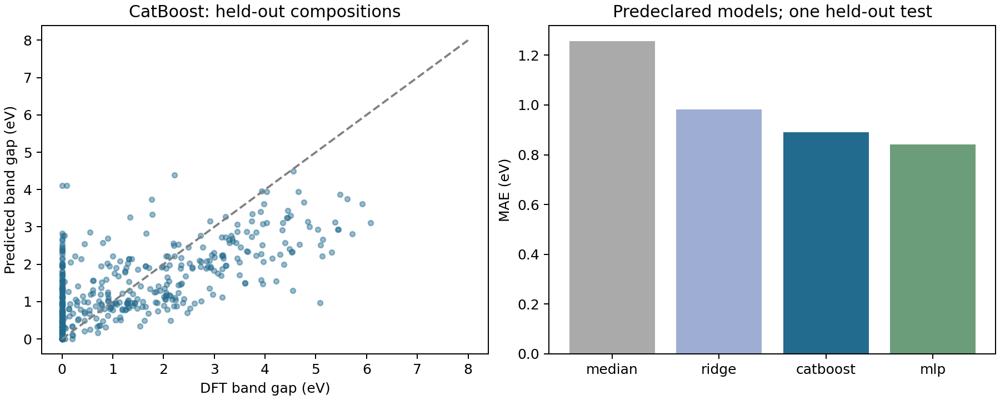

# Прогноз ширины запрещённой зоны 2D-материалов

Регрессия DFT band gap по элементному составу. Данные MC2D: 3 078 исходных строк; после отбора объектов с целевым свойством и разбираемой формулой — 2 252 строки, 2 084 приведённых состава.

## Протокол

Признаки — атомные доли 118 элементов. Один приведённый состав целиком относится к одной выборке. Обучение: 1 797 строк; тест: 455. Пять GroupKFold-разбиений внутри обучающей выборки. Модели и настройки зафиксированы до проверки теста; выбор модели — по среднему CV MAE. Стандартизация обучается внутри каждого фолда. UUID, источники и другие расчётные свойства не используются как признаки.

## Результат

CatBoost выбран по CV: тестовый MAE 0,890 эВ, RMSE 1,169 эВ, R² 0,442. Медианный прогноз: MAE 1,257 эВ. Снижение MAE — 29,2%. MLP дал меньший тестовый MAE 0,842 эВ, но не заменяет выбранную модель задним числом: выбор выполнен до обращения к тесту.

95%-интервал кластерного bootstrap по составам: MAE 0,815–0,971 эВ; R² 0,345–0,520. Это оценка неопределённости на данной тестовой выборке, не вариативности повторного обучения.

## Воспроизведение

Установить зависимости из requirements.txt. Запуск: `python train.py --data path/to/MC2D_processed.csv --output results`. Исходный CSV не распространяется; это локальная таблица MC2D, её контрольная сумма сохранена в protocol.json. Протокол и составы в split_manifest.csv позволяют проверить разбиение. Артефакты в корне — проверенный запуск; новый запуск пишет отдельную папку results. Версии окружения — environment.json. Для собственного CSV требуются те же столбцы и единицы целевого свойства.

## Область применения

Состав не различает полиморфы; структурных дескрипторов здесь нет. Band gap не является прямым прогнозом ёмкости, ресурса или пригодности аккумулятора. Полученная модель — воспроизводимый базовый эксперимент для анализа материалов, а не замена физической проверки.

Повторный полный запуск воспроизвёл все тестовые прогнозы четырёх моделей. Проверка: reproduction_check.json.
